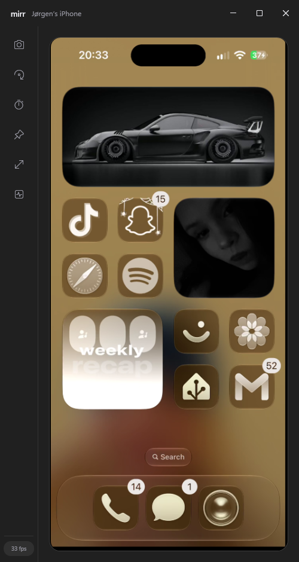

# mirr

Mirror an iPhone screen over USB in real time — a native Windows desktop app.

mirr talks to a connected iPhone over USB, streams its display to the PC, and renders
it inside a frameless, phone-proportioned window. No QuickTime, no browser, no cloud:
the video never leaves the USB cable.



## Features

- Real-time mirroring of any iPhone or iPad display over USB (iOS 17+)
- Hardware-quality HEVC decode through FFmpeg (PyAV), driven by an embedded bridge process
- Frameless window with Mica backdrop, immersive dark mode, and a rounded phone viewport
- Minimalist control rail: screenshot, orientation flip, presentation rate (15/30/60 fps), always-on-top, fullscreen
- Fullscreen mode (borderless, covers the taskbar; Esc to leave)
- Automatic device preparation: mounts the Developer Disk Image and recovers the stream on its own
- Live status (connection, fps) with automatic reconnection, trust prompts, and stream recovery
- Single-file executable

## Tech stack

| Layer | Technology |
| --- | --- |
| UI | WPF (.NET 10), Mica system backdrop via DWM, custom chrome |
| Video decode | FFmpeg via PyAV, in an embedded Python bridge process (binary pipes) |
| Pixel path | BGRA frames presented through a `WriteableBitmap` on the compositor thread |
| Device link | [pymobiledevice3](https://github.com/doronz88/pymobiledevice3) (external engine process) |
| Transport | HTTP chunked stream of RFC 7798 depacketized HEVC access units over the CoreDevice tunnel |

mirr drives Apple's own `DisplayService` through pymobiledevice3's `serve-web` pipeline.
The device encodes its screen as HEVC, sends it as RTP over the CoreDevice tunnel,
pymobiledevice3 depacketizes it into access units, and mirr fetches them over loopback
HTTP and forwards each access unit (converted to Annex-B) to the embedded decode bridge.
The bridge decodes with FFmpeg and returns BGRA frames on stdout, which mirr presents
directly. mirr runs pymobiledevice3 and the decode bridge as separate processes, so each
project keeps its own license: mirr is MIT; the engine and FFmpeg build remain under
their own terms.

## Build

Requirements: Windows 10 1903+ (Windows 11 recommended for the Mica backdrop) and the
[.NET 10 SDK](https://dotnet.microsoft.com/download/dotnet/10.0).

```powershell
git clone https://github.com/mirr-app/mirr.git
cd mirr
dotnet build mirr.sln
```

The debug binary lands in `src\mirr\bin\Debug\net10.0-windows\mirr.exe`.

To produce a framework-dependent single-file release:

```powershell
scripts\publish.ps1
```

Artifacts land in `artifacts\publish\`. The published executable is framework-dependent,
so end users need the [.NET 10 Desktop Runtime](https://dotnet.microsoft.com/download/dotnet/10.0/runtime).
Set `MIRR_RUNTIME` to target another RID (for example `win-arm64`). Regenerate the
application icon after changing its drawing code with `scripts\make-icon.ps1`.

## iOS setup

1. **USB drivers** — install [iTunes from apple.com](https://www.apple.com/itunes/)
   (not the Microsoft Store version) so the Apple Mobile Device USB driver and the
   usbmuxd service are present. Plug the iPhone in and trust the computer if asked.
2. **Python engine** — mirr needs Python **3.10–3.12** with pymobiledevice3 and PyAV
   (Python 3.13+ has no Windows wheels yet for pymobiledevice3's native dependencies):

   ```powershell
   py -3.12 -m pip install -U pymobiledevice3 av
   ```

   mirr auto-discovers a `pymobiledevice3` install or a `py`/`python` interpreter.
3. **Developer Mode** — on the iPhone open
   *Settings → Privacy & Security → Developer Mode* and turn it on (requires a
   restart, then confirm with the passcode). This is required for the mirroring service.
4. **Trust** — the first launch shows *Trust needed*: unlock the phone and tap *Trust*,
   then re-enter the passcode when prompted.
5. **Developer Disk Image** — mirr mounts it automatically on first connect (this needs
   a one-time download and can take a minute). It stays mounted until the device reboots.
6. **Audio note** — while a mirroring session is active the device shows the screen
   share indicator; camera and microphone cannot be used by other apps during capture
   (and mirroring will not start while Camera or Voice Memos holds them).

## Troubleshooting

| Symptom | Fix |
| --- | --- |
| *Engine missing* | Install pymobiledevice3 with Python 3.10–3.12, then press the status pill |
| *Failed — PyAV is required* | `py -3.12 -m pip install av` |
| *Trust needed* | Unlock the iPhone and tap *Trust*; Developer Mode must be on |
| Stuck on *Preparing device* | The Developer Disk Image download needs network access on first run |
| Black screen, status *Linking* | Wake the device display; the encoder only runs while the screen is awake |
| Nothing happens on plug-in | Check `pymobiledevice3 usbmux list` shows the device; reinstall iTunes drivers if empty |
| Camera/Voice Memos black during mirroring | Expected — stop mirroring before recording with them |

Engine output (pymobiledevice3 stderr) is available from the status pill or the log
button in the control rail, and mirr also writes a session log to
`%LOCALAPPDATA%\mirr\mirr.log`.

## Project layout

```
src/mirr
├── Bridge/        embedded Python decode bridge (FFmpeg via PyAV)
├── Interop/       DWM and user32 P/Invoke
├── Media/         codec parsing, Annex-B conversion, decode bridge host, pipeline
├── Engine/        engine locator, usbmux monitor, Developer Disk Image, engine process
├── Services/      mirror session orchestration and recovery
├── ViewModels/    presentation state, throttling, screenshots
├── Views/         frameless main window, engine log window
├── Controls/      letterboxing viewport panel
└── Themes/        dark theme, control styles
```

## Known limitations

These are properties of Apple's USB screen-mirroring protocol (`DisplayService`) and of
iOS itself, not of mirr's own code:

| Feature | Status | Notes |
| --- | --- | --- |
| **Video** | ✅ Working | HEVC; the device encoder only emits while the screen changes (~30 fps on a static screen, up to ~55 fps under motion). mirr presents every frame it receives, capped by the presentation-rate selector. |
| **Audio** | ❌ Not supported | The device streams its system audio as **AAC-ELD**. Decoding AAC-ELD requires Apple's `AudioToolbox`, which is macOS-only; Windows ships no AAC-ELD decoder and FFmpeg's native decoder rejects ELD frames (verified against a real capture). mirr therefore has no audio. |
| **Camera (on device)** | ❌ Grey/black | While a mirroring session is active, iOS gives the capture pipeline exclusive use of the camera; the Camera app previews grey. |
| **Microphone (on device)** | ❌ Unavailable | Same cause: iOS routes the microphone to the mirroring session, so other apps cannot capture while mirr is mirroring. |

## License

[MIT](LICENSE). The bundled engine ([pymobiledevice3](https://github.com/doronz88/pymobiledevice3),
GPL-3.0) and the decode bridge's FFmpeg libraries are invoked as separate processes and
remain under their own terms.
